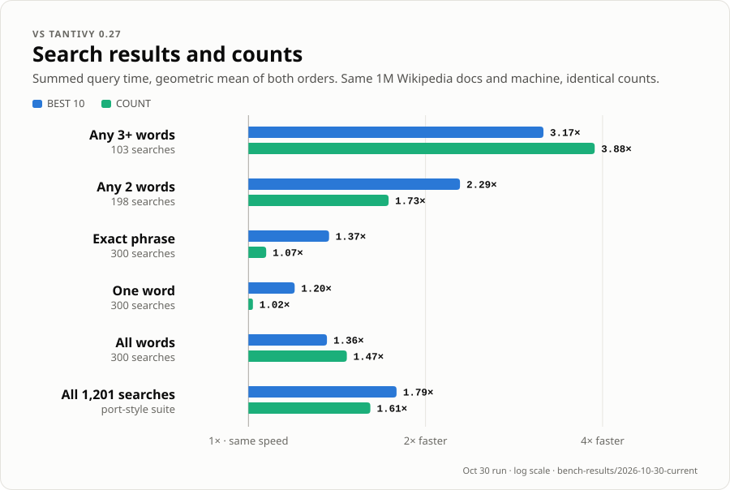
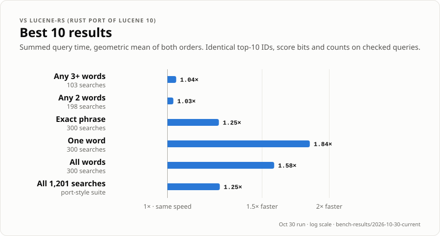
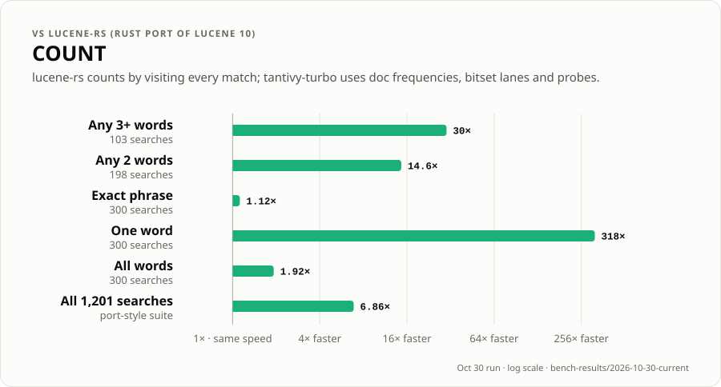
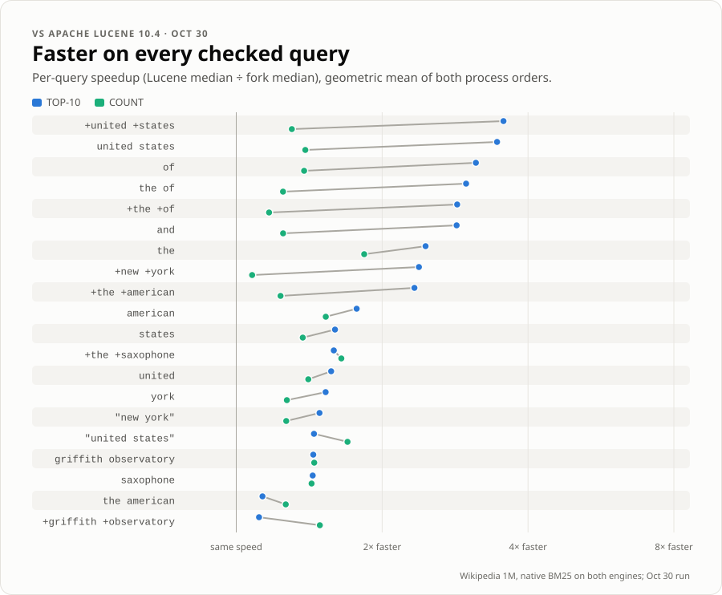
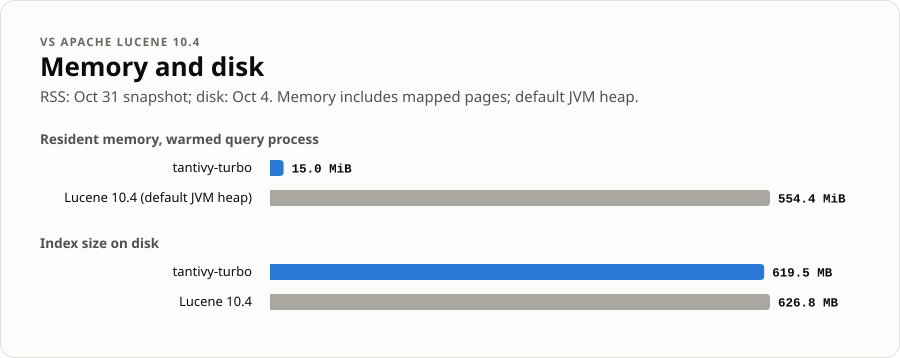
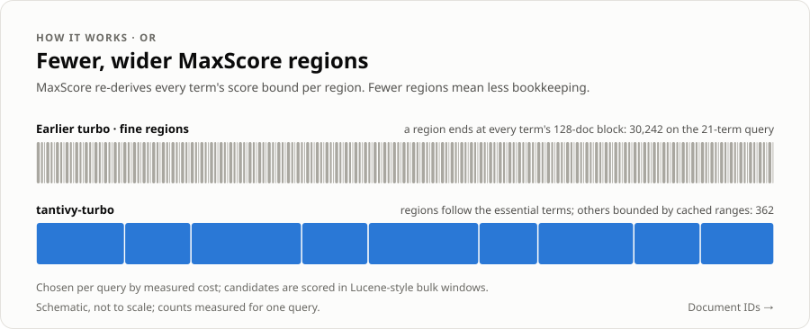
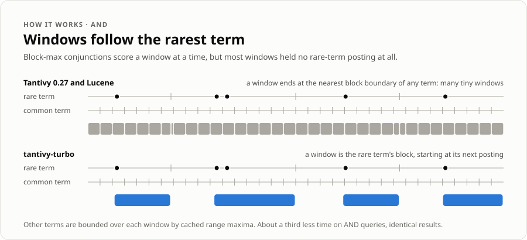

# tantivy-turbo: benchmarks and details

Back to the [README](README.md).

## Contents

- [At a glance](#at-a-glance)
- [Benchmarks](#benchmarks)
  - [How we measure](#how-we-measure)
  - [vs Tantivy 0.27](#vs-tantivy-027)
  - [vs lucene-rs](#vs-lucene-rs)
  - [vs Apache Lucene 10.4](#vs-apache-lucene-104)
- [How it works](#how-it-works)
- [Compatibility](#compatibility)
- [Correctness](#correctness)
- [Known limitations and roadmap](#known-limitations-and-roadmap)
- [Reproducing the benchmarks](#reproducing-the-benchmarks)
- [Credits and license](#credits-and-license)

<br>

## At a glance

| | vs **Tantivy 0.27** | vs **lucene-rs** (Lucene 10 port) | vs **Apache Lucene 10.4** |
| --- | :---: | :---: | :---: |
| TOP-10, typical query (geomean) | **1.34× faster** | **1.48× faster** | **1.96–1.98× faster**¹ |
| TOP-10, total time (1,201 queries) | **1.79× faster** | **1.25× faster** | n/a¹ |
| TOP-10, single term | **1.20× faster** | **1.84× faster** | n/a¹ |
| TOP-10, OR queries | **2.29–3.17× faster** | 2 terms **1.03× faster**, 3+ terms **1.04× faster** | n/a¹ |
| TOP-10, AND queries | **1.36× faster** | **1.58× faster** | faster on all 6¹ |
| TOP-10, phrase queries | **1.37× faster** | **1.25× faster** | n/a¹ |
| COUNT, total time | **1.61× faster** | **6.86× faster** | **1.34–1.41× faster**¹ |
| Results | identical match counts | identical checked top-10 IDs, score bits and counts | matching counts and top-10 ID sets; scores within tolerance |

<sub>¹ The Java Lucene comparison uses 20 Wikipedia queries and includes parsing and pipe latency. It is not directly comparable to the Rust timing protocol. Turbo had the lower median for all 20 queries in both modes and orders in this run.</sub>

<br>

## Benchmarks

### How we measure

- **Corpus:** the first 1,000,000 English Wikipedia articles; each engine uses a single-segment index from the same corpus.
- **Rust comparisons:** 1,201 port-style queries (300 term, 300 AND, 301 OR and 300 phrase), plus 20 Wikipedia queries. Workers use prebuilt queries, are pinned to one core, and run without query caching. Each order records 12 samples per query in both A→B and B→A orders after warmup.
- **Correctness:** 1,227 queries, including six extra correctness-only cases, were checked. Turbo matched its exhaustive scorer and the frozen reference; the lucene-rs top-10 IDs, score bits and counts matched the frozen reference; upstream Tantivy match counts matched turbo. Every timed Rust call was checked against its engine's verified result checksum.
- **Java Lucene:** 20 Wikipedia queries and a separate protocol that includes query parsing and pipe latency. Each process order uses 40 seconds of warmup and 128 iterations per query. Counts and top-10 ID sets matched, and shared top-100 scores were within 2×10⁻⁶ relative tolerance.
- **Machine and build:** Intel Core Ultra 7 255H laptop, Rust 1.99, `-C target-cpu=native`, fat LTO; OpenJDK 21 for Java. Timings ran October 30, 2026, with other processes active (Rust-run load averages approximately 5–6). AC power was disconnected when checked before the run; continuous power state was not recorded.

The Rust comparisons measured commit `c2aabd490bc5c32ec2981811ffe26210694b8e3a`; absolute times should be compared only within the same table and process order. Background load and laptop power management can affect small differences. Each table's displayed latency is the mean of the two order-specific averages of per-query medians. Time ratios are turbo divided by the baseline; below 1 means turbo was faster. “Typical query” is the geometric mean of per-query ratios, combined across both orders. Earlier reports remain available separately; disk-size figures and the demo video are historical. See the [measurement evidence](bench-results/2026-10-30-current).

<br>

### vs Tantivy 0.27

<p align="center">
  <picture>
    <source media="(prefers-color-scheme: dark)" srcset="assets/vs-tantivy-dark.svg">
    
  </picture>
</p>

Both engines use the same source documents but independently built indexes and scoring statistics. Match counts agreed on all 1,227 checked queries; internal document IDs are not comparable between the indexes, and score or ranking equality is not claimed. Within upstream Tantivy, optimized and exhaustive top-10 IDs and order matched, while score bits differed on 69 queries by at most two ULPs.

| TOP-10 | Queries | turbo | Tantivy 0.27 | Time ratio (AB / BA) | Typical query | Queries faster |
| --- | ---: | ---: | ---: | ---: | ---: | ---: |
| OR, 3+ terms | 103 | 286 µs | 908 µs | 0.32 / 0.31 | 0.40 | 102 / 102 |
| OR, 2 terms | 198 | 71.2 µs | 163 µs | 0.44 / 0.44 | 0.49 | 198 / 197 |
| Phrase | 300 | 286 µs | 392 µs | 0.74 / 0.71 | 0.92 | 129 / 127 |
| Single term | 300 | 11.8 µs | 14.2 µs | 0.84 / 0.83 | 0.87 | 225 / 244 |
| AND | 300 | 81.0 µs | 110 µs | 0.74 / 0.73 | 0.86 | 125 / 115 |
| **All 1,201** | 1,201 | 131 µs | 234 µs | 0.57 / 0.55 | 0.75 | 779 / 785 |
| Wikipedia 20 | 20 | 187 µs | 1,109 µs | 0.17 / 0.16 | 0.54 | 14 / 15 |

<details>
<summary><b>COUNT results</b></summary>

| COUNT | Queries | turbo | Tantivy 0.27 | Time ratio (AB / BA) | Typical query | Queries faster |
| --- | ---: | ---: | ---: | ---: | ---: | ---: |
| OR, 3+ terms | 103 | 251 µs | 974 µs | 0.26 / 0.25 | 0.50 | 81 / 80 |
| OR, 2 terms | 198 | 54.6 µs | 94.5 µs | 0.58 / 0.58 | 0.96 | 96 / 92 |
| Phrase | 300 | 347 µs | 372 µs | 0.94 / 0.93 | 1.00 | 117 / 128 |
| Single term | 300 | 0.6 µs | 0.6 µs | 1.01 / 0.96 | 0.98 | 192 / 236 |
| AND | 300 | 84.4 µs | 124 µs | 0.69 / 0.67 | 0.86 | 181 / 185 |
| **All 1,201** | 1,201 | 139 µs | 223 µs | 0.63 / 0.61 | 0.90 | 667 / 721 |
| Wikipedia 20 | 20 | 420 µs | 1,491 µs | 0.28 / 0.29 | 0.53 | 17 / 17 |

</details>

- **The aggregate win is concentrated in OR.** In TOP-10, 3+ term ORs were 3.17× faster in total and 2-term ORs 2.29× faster. Individual queries can still be slower.
- **Close cases:** single-term COUNT was almost level and slightly slower in one order; phrase COUNT was about 1.07× faster in total but level for the typical query.
- **Resources:** historical index-size and heap figures are retained in the [earlier report](bench-results/turbo-vs-tantivy-0.27). In this run the warmed process RSS was about 292 MiB for turbo and 323 MiB for upstream; mapped pages and warmup strongly affect RSS.

Data: [October 30 evidence](bench-results/2026-10-30-current), with the [October 23 results](bench-results/turbo-vs-tantivy-0.27) retained separately.

<br>

### vs lucene-rs

[lucene-rs](https://github.com/pc-style/lucene-rs) is a Rust port of Apache Lucene 10, including its MaxScore and impacts machinery. It's the most direct "Lucene algorithms in Rust" baseline available. On the 1,227 checked queries, both engines returned identical top-10 IDs, score bits and counts against the frozen reference. The two APIs use different total-hit thresholds, so this result is specific to the checked workload.

<p align="center">
  <picture>
    <source media="(max-width: 600px) and (prefers-color-scheme: dark)" srcset="assets/vs-lucene-rs-mobile-dark.svg">
    <source media="(max-width: 600px)" srcset="assets/vs-lucene-rs-mobile-light.svg">
    <source media="(prefers-color-scheme: dark)" srcset="assets/vs-lucene-rs-dark.svg">
    
  </picture>
</p>

| TOP-10 | Queries | turbo | lucene-rs | Time ratio (AB / BA) | Typical query | Queries faster |
| --- | ---: | ---: | ---: | ---: | ---: | ---: |
| OR, 3+ terms | 103 | 276 µs | 287 µs | 0.98 / 0.95 | 0.93 | 69 / 68 |
| OR, 2 terms | 198 | 66.1 µs | 67.8 µs | 0.95 / 1.00 | 0.72 | 154 / 138 |
| Phrase | 300 | 271 µs | 338 µs | 0.81 / 0.79 | 0.71 | 264 / 264 |
| Single term | 300 | 11.0 µs | 20.3 µs | 0.55 / 0.53 | 0.60 | 290 / 292 |
| AND | 300 | 75.8 µs | 120 µs | 0.63 / 0.64 | 0.62 | 269 / 264 |
| **All 1,201** | 1,201 | 124 µs | 155 µs | 0.80 / 0.80 | 0.67 | 1,046 / 1,026 |
| Wikipedia 20 | 20 | 188 µs | 222 µs | 0.86 / 0.84 | 0.59 | 17 / 17 |

**What this means:**
- **Typical query:** turbo was **1.48× faster** by the geometric mean and won 1,046 / 1,026 of 1,201 queries in the two orders.
- **Total time:** turbo was **1.25× faster** for TOP-10. Two-term OR was close to even in one order; individual queries can be slower.
- **Long OR:** 3+ term ORs were **1.04× faster** in total and won 69 / 68 of 103 queries.

<p align="center">
  <picture>
    <source media="(prefers-color-scheme: dark)" srcset="assets/vs-lucene-rs-count-dark.svg">
    
  </picture>
</p>

<details>
<summary><b>COUNT results</b></summary>

| COUNT | Queries | turbo | lucene-rs | Time ratio (AB / BA) | Typical query | Queries faster |
| --- | ---: | ---: | ---: | ---: | ---: | ---: |
| OR, 3+ terms | 103 | 239 µs | 7,162 µs | 0.03 / 0.03 | 0.05 | 103 / 103 |
| OR, 2 terms | 198 | 51.3 µs | 750 µs | 0.07 / 0.07 | 0.11 | 197 / 197 |
| Phrase | 300 | 338 µs | 380 µs | 0.90 / 0.89 | 0.73 | 255 / 270 |
| Single term | 300 | 0.6 µs | 187 µs | < 0.01 / < 0.01 | 0.02 | 300 / 300 |
| AND | 300 | 81.6 µs | 157 µs | 0.52 / 0.52 | 0.52 | 282 / 283 |
| **All 1,201** | 1,201 | 134 µs | 919 µs | 0.15 / 0.14 | 0.16 | 1,137 / 1,153 |
| Wikipedia 20 | 20 | 435 µs | 3,404 µs | 0.13 / 0.12 | 0.02 | 20 / 20 |

</details>

COUNT is lopsided because lucene-rs counts by visiting every match. Turbo uses document-frequency shortcuts and bitset windows for these cases. In this run the warmed process RSS was about 291 MiB for turbo and 316 MiB for lucene-rs; RSS includes mapped pages and varies with warmup. Data: [October 30 evidence](bench-results/2026-10-30-current), with [October 23 results](bench-results/turbo-vs-lucene-rs) retained separately.

<br>

### vs Apache Lucene 10.4

This October 30 comparison uses the search-benchmark-game Wikipedia 1M index and its 20 queries. **Both engines use native BM25 (k1 1.2, b 0.75) with their own collection statistics.** The top-ten ID sets matched, with order differences permitted for ties; common top-100 scores differed by at most 5.72×10⁻⁸ relative, within the 2×10⁻⁶ tolerance.

<p align="center">
  <picture>
    <source media="(prefers-color-scheme: dark)" srcset="assets/lucene-per-query-dark.svg">
    
  </picture>
</p>

| Fork / Lucene geometric mean | Fork process first | Lucene process first |
| --- | ---: | ---: |
| TOP-10 | **0.505 (1.98× faster)** | **0.510 (1.96× faster)** |
| COUNT | **0.746 (1.34× faster)** | **0.710 (1.41× faster)** |
| Queries with the lower median | 20 / 20 | 20 / 20 |

<p align="center">
  <picture>
    <source media="(prefers-color-scheme: dark)" srcset="assets/resources-dark.svg">
    
  </picture>
</p>

- **Memory:** in a separate October 31 warmed-process snapshot, tantivy-turbo used **15.0 MiB RSS**, against **554.4 MiB for Lucene** using the default JVM heap (558.1 MiB high-water RSS). These include mapped pages and depend on warmup and JVM configuration; a constrained JVM heap was not measured. See the [memory receipt](bench-results/2026-10-30-current/java/memory-current.json).
- **Storage measurement:** the index-size figures are from October 4 on an earlier build and were not remeasured here. See the [historical native comparison](doc/performance/lucene-10.4/results/2026-10-04-native/README.md).

<br>

## How it works

<p align="center">
  <picture>
    <source media="(prefers-color-scheme: dark)" srcset="assets/regions-dark.svg">
    
  </picture>
</p>

### OR queries: MaxScore with adaptive regions

Top-k disjunctions use **MaxScore**. Terms are ordered by how much they can contribute. Low-impact *optional* terms are only checked for documents that the high-impact *essential* terms surface and that could still enter the top-k. The pieces:

- **MaxScore for 3–32 terms** with compact per-clause state, certified global prefixes, an exact cached threshold cutoff, and batched scoring when a single term drives the candidates.
- **Two-term OR** pruned by its essential term in fixed local score regions.
- **Adaptive coarse regions:**
  - **The problem:** MaxScore splits the doc-ID space into regions and re-derives each term's score bound per region. An earlier turbo build ended a region at every term's 128-document block boundary. For a 21-term query that meant 30,242 regions, each costing work for every term.
  - **The probe:** tantivy-turbo starts each query on that fine geometry and measures it. If region bookkeeping outweighs candidate work (fewer than 16 candidates per term per region), it tries wide regions, then keeps whichever geometry measures cheaper.
  - **The bounds:** wide regions are bounded by **cached range maxima over the skip data the index already stores**, so no format change is needed. Non-leading terms are capped at 256-block groups, and a region shrinks again when looser bounds would promote a term to essential.
  - **The result:** the 21-term query drops to 362 regions and runs **2× faster**. Long OR queries overall take **15% less time** than before this change, with identical results.

### Bulk scoring for long OR queries

New in this release, and all exact: results are bit-identical to the previous build on every gate.

- **Batch filtering:** when one term drives the candidates, its scored batch of 128 postings is filtered against an exact leaf cutoff. Each comparison is the same predicate as the first optional-term test, solved once per batch by bisection over f32 bits. Only survivors take the per-candidate path.
- **Windows for several essential terms:** like Lucene's `MaxScoreBulkScorer`, dense essential terms are batch-scored into 4,096-document windows (a bitmap plus f64 sums in clause order). Candidates are compacted without branching on an exact precomputed sum cutoff. Only candidates that could enter the top-k recover their leaves for the canonical, clause-ordered score.
- **Choosing the geometry by cost:** the switch between fine and coarse regions is re-measured once the threshold has warmed up. The query keeps whichever costs less per document; the cost counts region bookkeeping, candidates and covering-bound blocks.
- **Cheaper bounds and skipping:** galloping skip-directory lookups hinted by the previous region, direct leaf maxima for short ranges, and skips over many blocks that read only each block's last doc and size.
- **Dense blocks:** bitset blocks decode a byte at a time from a lookup table.
- **Repeated terms are scored once:** like Lucene's rewrite of repeated SHOULD clauses, `to be or not to be` scores 4 terms instead of 6. The published sum still adds each leaf at every original clause position.

### AND queries: windows that follow the rarest term

<p align="center">
  <picture>
    <source media="(prefers-color-scheme: dark)" srcset="assets/and-windows-dark.svg">
    
  </picture>
</p>

Block-max conjunctions (Tantivy's and Lucene's) end each window at the nearest block boundary of *any* term, so a dense term chops the rare term's range into many tiny windows that each pay for bound checks. tantivy-turbo instead:

- ends each window at the rare leader's block, bounding the other terms over it with their cached range maxima (level-1 groups for long ranges);
- starts the next window at the leader's next posting, skipping stretches that cannot contain a match;
- filters leaders with a single conservative cut, since the second pass rechecks every candidate exactly.

In the October 30 run, AND TOP-10 total time was about 1.36× faster than Tantivy 0.27; individual queries varied.

### Level-1 skip data

Like Lucene's two-level skip lists and impacts, every 32 full blocks of a term get one fixed-width record after the per-block skip records: the group's byte and position offsets, and one max-score input pair selected over all the group's postings (with the same rule that selects a block's pair, so its bound is sound for the same reason).

- **Skipping:** long skips jump whole groups instead of reading every block's record.
- **Bounds:** score bounds over more than a few blocks use the whole groups covering them, without resolving each block.
- **Cost:** 0.18% larger postings for the benchmark index.
- **Compatibility:** readers detect the records from the skip data's length. Indexes without them (Tantivy 0.27, older tantivy-turbo) read as before, and older tantivy-turbo builds ignore the records.

Short OR queries that mix a stopword with rarer terms gained the most: `medal of honor` and `the news journal` execute 40–50% fewer instructions.

### Lucene-equivalent scoring

- **Arithmetic:** native Lucene 10 BM25, with f64 accumulation in clause order and a single f32 cast.
- **Statistics:** overlap-discounted norms, exact persisted field statistics (document count and token totals), and BM25 parameters configurable per searcher.
- **Phrases:** Lucene-correct sloppy-phrase traversal and frequency.
- **Verification:** on the 20-query Java comparison, shared top-100 scores matched within a relative tolerance of 2×10⁻⁶; see the correctness evidence above.

### COUNT and storage

- independent mask lanes for medium-density terms, with lane horizon checks amortized over four postings;
- streamed exact positions for phrase counts;
- PFOR exceptions for outlier term frequencies, which shrink frequency payloads by 31%.

<br>

## Compatibility

- **API:** the Tantivy 0.27 API, imported as `tantivy`. Additions include per-searcher BM25 parameters and exact field statistics.
- **Rust:** 1.87 is the declared minimum; compiler requirements can vary with enabled features and dependency versions.
- **Reading old indexes:** **tantivy-turbo reads indexes written by Tantivy 0.27.**
- **Not the other way round:** Tantivy 0.27 cannot read indexes written by tantivy-turbo, because they carry extra field statistics and block-bound metadata. Switching is easy; switching back means reindexing.
- **Level-1 skip data:** written for new and merged segments. Older segments work without it, at lower long-OR speed; a merge (for example `tantivy::indexer::merge_indices`) rewrites them.
- **Cargo features:** the same as Tantivy (`mmap`, `lz4-compression`, `zstd-compression`, `stemmer`, `quickwit`, ...).
- **Lucene parity:** scoring and the core query types (term, boolean, phrase, sloppy phrase, phrase prefix) match Lucene 10. Full Lucene feature and public-API parity is a longer-term goal and is not complete; see the [parity scope](doc/performance/lucene-10.4/parity).

<br>

## Correctness

The recorded within-fork optimization gates compared results **bit-for-bit**:

- **Exact gates:** top-10 document IDs, f32 score bits and match counts are compared against the previous accepted build on three 1,227-query gates (default BM25, k1 0.9/b 0.4, and k1 2/b 1). They are also compared against an exhaustive scorer. The level-1 build passes them on the re-encoded index against results recorded on the original index.
- **Tests:** a recorded full workspace run passed 2,185 tests with every feature enabled (9 ignored). That included exhaustive-equality fixtures that force the coarse-region path, and forced hand-backs to fine regions, on every OR fixture, plus fixtures with repeated terms.
- **End-to-end differential test** ([`tests/pruning_exactness.rs`](tests/pruning_exactness.rs)): eight generated multi-segment indexes, with and without deletions, exercise dense and sparse terms, duplicates, longer ORs, exclusions, and three BM25 parameter sets. In release mode, 14,400 query/configuration checks compare pruned top-1/10/100 results and score bits with a full scan, and both count paths with the match count. Deliberately planted pruning bugs in the OR and AND paths make it fail.
- **Index robustness:** level-1 skip records are only used when their offsets move forward and stay inside the term's postings; corrupted offsets fall back to block-by-block skipping (tested).
- **CI:** the fork runs feature-matrix tests, release-mode search correctness, a paired search-performance check, long-running tests and coverage. See the [current Actions runs](https://github.com/Priyansh4444/tantivy-turbo/actions) for their results.
- **Security reports:** use the private reporting process in [SECURITY.md](SECURITY.md). Dependency and audit results change over time and should be checked against the revision being used.
- **One frozen ruler:** every optimization attempt, kept or reverted, was judged by the same frozen benchmark ruler. 34 attempts and their raw samples are published under [`doc/performance/lucene-10.4/results`](doc/performance/lucene-10.4/results).

<br>

## Known limitations and roadmap

- **Long OR queries:** 1.04× faster than lucene-rs on total time, but some 3-term queries are still 1.2–1.3× slower (`world bank president`, `us coast guard`).
- **Phrase COUNT:** approximately level with Tantivy 0.27 on the typical query (about 1.07× faster in total in this run).
- **Index compatibility:** turbo-written indexes can't be opened by upstream Tantivy.
- **Lucene API parity:** not complete beyond scoring and the core query types.

<br>

## Reproducing the benchmarks

| Comparison | Driver | Data |
| --- | --- | --- |
| vs Tantivy 0.27 | [`compare.py`](bench-results/turbo-vs-tantivy-0.27/compare.py) plus the [upstream worker and indexer](bench-results/turbo-vs-tantivy-0.27/upstream-harness) | [October 30 evidence](bench-results/2026-10-30-current) |
| vs lucene-rs | [`compare.py`](bench-results/turbo-vs-lucene-rs/compare.py) | [October 30 evidence](bench-results/2026-10-30-current) |
| vs Lucene 10.4 | [Lucene 10.4 harness and instructions](doc/performance/lucene-10.4/README.md) | [October 30 evidence](bench-results/2026-10-30-current); [October 4 report](doc/performance/lucene-10.4/results/2026-10-04-native) |

What you need to know to rerun them:
- **Shared harness:** the drivers use the frozen worker protocol from the [OR hillclimb audit](doc/performance/lucene-10.4/results/2026-10-12-or-hillclimb-audit). Paths inside them point at the author's machine; adjust them to your corpus and index locations.
- **Corpus:** build the 1M-document corpus with the [configured Wikipedia replay](doc/performance/lucene-10.4/configured-wiki.md).
- **Charts:** regenerate every chart with `python3 bench-results/make_charts.py`.

<br>

## Demo video

The [demo video](demo/tantivy-turbo-demo.mp4) uses historical benchmark results; its search example is illustrative. See [the demo notes](demo/README.md) for each displayed measurement and its limitations.

```bash
cd demo
cargo run --release -- preview                # real-time window
cargo run --release -- render -o demo.mkv     # 1080p VP9; then e.g. ffmpeg -i demo.mkv demo.mp4
```

See [`demo/README.md`](demo/README.md) for details.

<br>

## Credits and license

- **Origin:** tantivy-turbo is a fork of [Tantivy](https://github.com/quickwit-oss/tantivy), created by Paul Masurel and developed by the Quickwit team and contributors. Their history is preserved; see [AUTHORS](AUTHORS) and [README.tantivy.md](README.tantivy.md).
- **Baselines:** the lucene-rs baseline is [pc-style/lucene-rs](https://github.com/pc-style/lucene-rs), and Lucene results come from [Apache Lucene](https://lucene.apache.org/) 10.4 via the [search-benchmark-game](https://github.com/quickwit-oss/search-benchmark-game) engine.
- **License:** MIT, like Tantivy ([LICENSE](LICENSE)).
- **Affiliation:** not affiliated with or endorsed by the Tantivy, Quickwit, lucene-rs or Apache Lucene projects.
