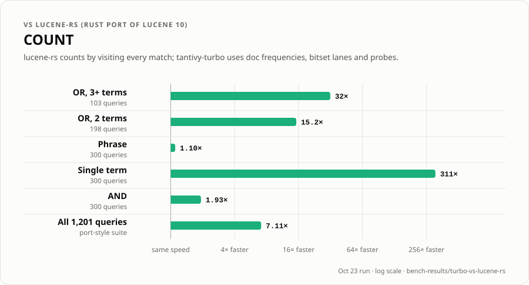
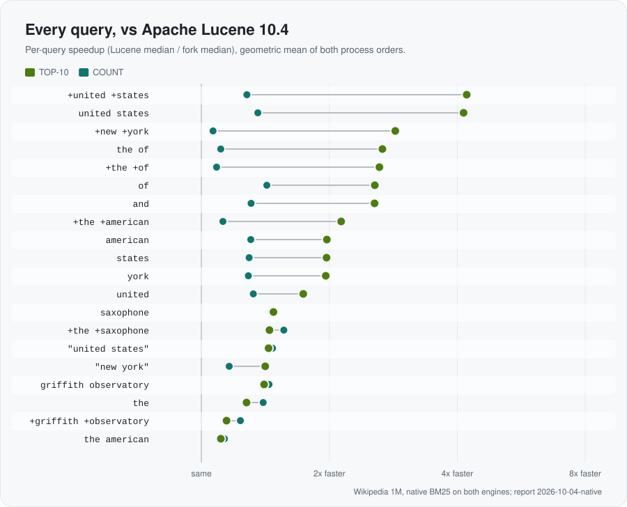
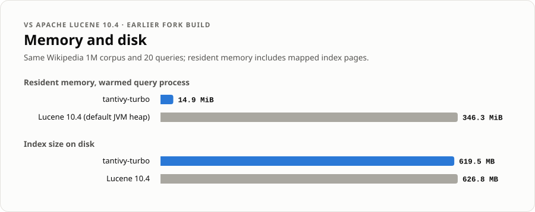
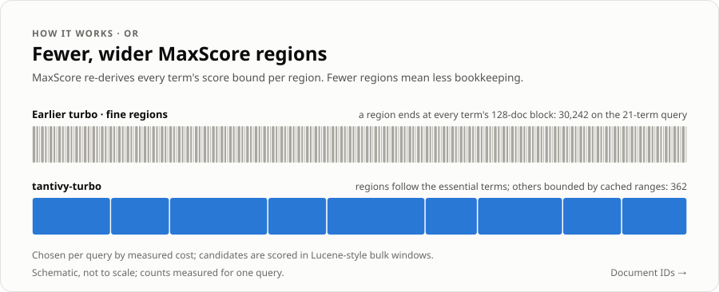
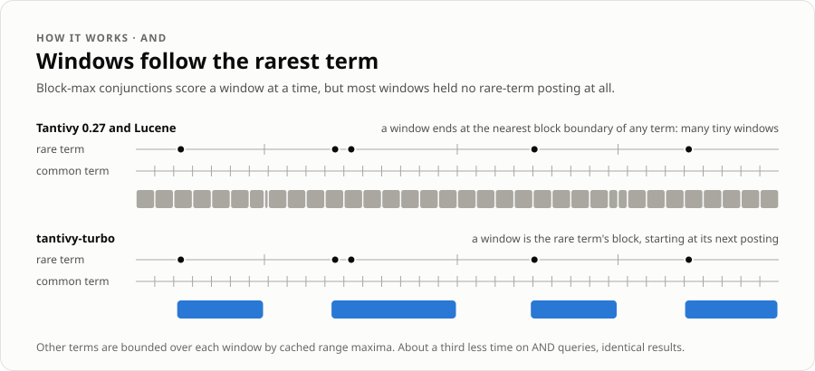

# tantivy-turbo: benchmarks and details

Back to the [README](README.md).

## Contents

- [At a glance](#at-a-glance)
- [Benchmarks](#benchmarks)
  - [How we measure](#how-we-measure)
  - [vs Tantivy 0.27](#vs-tantivy-027)
  - [vs lucene-rs](#vs-lucene-rs)
  - [vs Apache Lucene 10.4](#vs-apache-lucene-104)
- [How it works](#how-it-works)
- [Compatibility](#compatibility)
- [Correctness](#correctness)
- [Known limitations and roadmap](#known-limitations-and-roadmap)
- [Reproducing the benchmarks](#reproducing-the-benchmarks)
- [Credits and license](#credits-and-license)

<br>

## At a glance

| | vs **Tantivy 0.27** | vs **lucene-rs** (Lucene 10 port) | vs **Apache Lucene 10.4** |
| --- | :---: | :---: | :---: |
| TOP-10, typical query (geomean) | **1.34× faster** | **1.49× faster** | **1.82–2.09× faster** |
| TOP-10, total time (1,201 queries) | **1.79× faster** | **1.25× faster** | n/a¹ |
| TOP-10, single term | **1.18× faster** | **1.85× faster** | n/a¹ |
| TOP-10, OR queries | **2.3–3.3× faster** | 2 terms **1.02× faster**, 3+ terms **1.04× faster** | n/a¹ |
| TOP-10, AND queries | **1.35× faster** | **1.58× faster** | faster on all 6¹ |
| TOP-10, phrase queries | **1.37× faster** | **1.24× faster** | n/a¹ |
| COUNT, total time | **1.6× faster** (every query type) | **7.1× faster** (every query type) | **1.27–1.30× faster** |
| Results | identical match counts | identical top-10 IDs, scores and counts | identical raw BM25 scores |

<sub>¹ The Lucene 10.4 comparison uses the 20-query search-benchmark-game Wikipedia set (8 term, 6 AND, 4 OR, 2 phrase). The fork has the lower median latency on all 20 queries, for both TOP-10 and COUNT, in both process orders.</sub>

<br>

## Benchmarks

### How we measure

- **Corpus:** the first 1,000,000 English Wikipedia articles. Each engine builds a single-segment index from the same JSONL.
- **Queries:** 1,201 "port-style" queries: 300 single-term, 300 AND, 301 OR (103 with 3+ terms, 198 with 2) and 300 phrase. Also the 20 search-benchmark-game Wikipedia queries.
- **Warm, persistent workers.** Each engine runs as a long-lived process pinned to one core, with the query cache disabled.
- **Interleaved, both orders.** For every query, both engines run back-to-back in rounds of 12 iterations, first in A→B order and then B→A. Ratios use summed per-query medians. "Typical query" is the geometric mean of per-query ratios.
- **Results are checked during timing.** Every timed call's checksum is compared against a frozen correctness dump.
- **Machine:** Intel Core Ultra 7 255H laptop on AC power, Rust 1.99, `-C target-cpu=native`, fat LTO.

Absolute microseconds are only comparable within one table, because each table is a separate run. The saved comparisons with Tantivy and lucene-rs were measured on October 23, before the October 26 skip-reader fix, and have not been remeasured at the current HEAD. The tables were measured on battery, and ratios between separate runs vary by a few percent; typical-query ratios of very short queries (a few microseconds) vary the most. tantivy-turbo's index is the same 1M-document index re-encoded by a single-segment merge to add level-1 skip data; documents and doc IDs are unchanged.

<br>

### vs Tantivy 0.27

<p align="center">
  <picture>
    <source media="(prefers-color-scheme: dark)" srcset="assets/vs-tantivy-dark.svg">
    
  </picture>
</p>

Both engines index the same documents. Each uses its own default text analysis and scoring, so match counts are identical on all 1,227 queries, but top-10 scores differ slightly. A time ratio below 1 means tantivy-turbo is faster.

| TOP-10 | Queries | turbo | Tantivy 0.27 | Time ratio (AB / BA) | Typical query | Queries faster |
| --- | ---: | ---: | ---: | ---: | ---: | ---: |
| OR, 3+ terms | 103 | 294 µs | 962 µs | **0.30 / 0.31** | 0.41 | 101 / 102 |
| OR, 2 terms | 198 | 70.9 µs | 164 µs | **0.43 / 0.43** | 0.48 | 197 / 198 |
| Phrase | 300 | 304 µs | 416 µs | **0.73 / 0.73** | 0.91 | 134 / 137 |
| Single term | 300 | 12.3 µs | 14.5 µs | **0.85 / 0.84** | 0.88 | 232 / 229 |
| AND | 300 | 81.3 µs | 110 µs | **0.74 / 0.74** | 0.85 | 121 / 124 |
| **All 1,201** | 1,201 | 136 µs | 244 µs | **0.56 / 0.56** | 0.75 | 785 / 790 |
| Wikipedia 20 | 20 | 198 µs | 1,265 µs | **0.16 / 0.15** | 0.53 | 15 / 15 |

<details>
<summary><b>COUNT results</b></summary>

| COUNT | Queries | turbo | Tantivy 0.27 | Time ratio (AB / BA) | Typical query | Queries faster |
| --- | ---: | ---: | ---: | ---: | ---: | ---: |
| OR, 3+ terms | 103 | 268 µs | 1,034 µs | **0.26 / 0.26** | 0.50 | 77 / 83 |
| OR, 2 terms | 198 | 56.5 µs | 97.4 µs | **0.58 / 0.58** | 0.96 | 79 / 90 |
| Phrase | 300 | 384 µs | 410 µs | 0.94 / 0.94 | 1.00 | 131 / 121 |
| Single term | 300 | 0.6 µs | 0.7 µs | 0.98 / 0.91 | 0.94 | 234 / 258 |
| AND | 300 | 88.6 µs | 131 µs | **0.68 / 0.67** | 0.86 | 171 / 197 |
| **All 1,201** | 1,201 | 151 µs | 240 µs | **0.63 / 0.63** | 0.89 | 692 / 749 |
| Wikipedia 20 | 20 | 492 µs | 1,631 µs | **0.30 / 0.30** | 0.54 | 18 / 18 |

</details>

- **The win is concentrated in OR.** OR queries with 3+ terms take under a third of the time, 2-term ORs under half. The Wikipedia-20 total drops 7×, and turbo is faster on 14 of those 20 queries.
- **Every query type is faster**, in both TOP-10 and COUNT total time. Single terms (1.18×) skip whole level-1 groups and score candidate blocks in batches; AND (1.35×) follows the rarest term's blocks instead of every term's, and jumps to its next posting.
- **Phrase COUNT is the closest:** 1.07× faster in total, level on the typical query.
- **Resources:** the index is 598 MB against 661 MB. tantivy-turbo's heap stays at about 1.7 MB; total RSS is dominated by memory-mapped index pages (roughly 190–240 MB for either engine, varying run to run with the page cache).

Data: [`bench-results/turbo-vs-tantivy-0.27`](bench-results/turbo-vs-tantivy-0.27).

<br>

### vs lucene-rs

[lucene-rs](https://github.com/pc-style/lucene-rs) is a Rust port of Apache Lucene 10, including its MaxScore and impacts machinery. It's the most direct "Lucene algorithms in Rust" baseline available. Both engines read the same corpus with the same Lucene-style analysis and scoring, and **return identical top-10 document IDs, f32 score bits and match counts on every query.** The comparison is therefore purely about speed.

<p align="center">
  <picture>
    <source media="(max-width: 600px) and (prefers-color-scheme: dark)" srcset="assets/vs-lucene-rs-mobile-dark.svg">
    <source media="(max-width: 600px)" srcset="assets/vs-lucene-rs-mobile-light.svg">
    <source media="(prefers-color-scheme: dark)" srcset="assets/vs-lucene-rs-dark.svg">
    
  </picture>
</p>

| TOP-10 | Queries | turbo | lucene-rs | Time ratio (AB / BA) | Typical query | Queries faster |
| --- | ---: | ---: | ---: | ---: | ---: | ---: |
| OR, 3+ terms | 103 | 295 µs | 307 µs | 0.96 / 0.96 | 0.92 | 75 / 72 |
| OR, 2 terms | 198 | 71.0 µs | 72.8 µs | 0.96 / 0.99 | 0.72 | 148 / 140 |
| Phrase | 300 | 303 µs | 374 µs | **0.81 / 0.81** | 0.69 | 266 / 266 |
| Single term | 300 | 12.1 µs | 22.4 µs | **0.55 / 0.53** | 0.59 | 295 / 295 |
| AND | 300 | 81.7 µs | 129 µs | **0.63 / 0.63** | 0.62 | 270 / 272 |
| **All 1,201** | 1,201 | 136 µs | 170 µs | **0.80 / 0.80** | 0.67 | 1,054 / 1,045 |
| Wikipedia 20 | 20 | 194 µs | 227 µs | **0.85 / 0.85** | 0.59 | 17 / 17 |

**What this means:**
- **Typical query:** tantivy-turbo is **1.49× faster** and wins on 1,054 / 1,045 of 1,201 queries (by run order).
- **Total time:** tantivy-turbo is **1.25× faster**, and faster on every query type, TOP-10 and COUNT. AND, previously level, is now **1.58× faster**.
- **Long-OR progress:** this release took 3+ term ORs from 1.47× slower than lucene-rs to **1.04× faster** (1.09× faster on the typical query, faster on 75 / 72 of 103). See [Bulk scoring](#bulk-scoring-for-long-or-queries) and [Level-1 skip data](#level-1-skip-data) below.

<p align="center">
  <picture>
    <source media="(prefers-color-scheme: dark)" srcset="assets/vs-lucene-rs-count-dark.svg">
    
  </picture>
</p>

<details>
<summary><b>COUNT results</b></summary>

| COUNT | Queries | turbo | lucene-rs | Time ratio (AB / BA) | Typical query | Queries faster |
| --- | ---: | ---: | ---: | ---: | ---: | ---: |
| OR, 3+ terms | 103 | 266 µs | 8,471 µs | **0.03 / 0.03** | 0.05 | 103 / 103 |
| OR, 2 terms | 198 | 55.0 µs | 838 µs | **0.07 / 0.07** | 0.11 | 197 / 198 |
| Phrase | 300 | 383 µs | 422 µs | 0.91 / 0.90 | 0.73 | 262 / 267 |
| Single term | 300 | 0.7 µs | 206 µs | **< 0.01 / < 0.01** | 0.02 | 300 / 300 |
| AND | 300 | 88.1 µs | 170 µs | **0.52 / 0.52** | 0.53 | 284 / 281 |
| **All 1,201** | 1,201 | 150 µs | 1,064 µs | **0.14 / 0.14** | 0.16 | 1,146 / 1,149 |
| Wikipedia 20 | 20 | 486 µs | 3,864 µs | **0.13 / 0.12** | 0.02 | 20 / 20 |

</details>

COUNT is lopsided because lucene-rs counts by visiting every match. tantivy-turbo answers single-term counts from document frequencies, and counts OR and AND matches with bitset windows and independent counting lanes. Both engines' resident memory is mostly memory-mapped index pages (about 190–240 MB here, varying with the page cache); tantivy-turbo's heap is about 1.7 MB. Data: [`bench-results/turbo-vs-lucene-rs`](bench-results/turbo-vs-lucene-rs).

<br>

### vs Apache Lucene 10.4

This comparison uses the search-benchmark-game Wikipedia 1M index and its 20 queries. **Both engines use native BM25 (k1 1.2, b 0.75) with their own collection statistics.** Sorted term statistics, stored IDs and encoded norms matched. The top-ten document ID sets matched, with order differences permitted for ties; common top-100 scores differed by at most 5.72×10⁻⁸ relative, within the 2×10⁻⁶ tolerance.

<p align="center">
  <picture>
    <source media="(prefers-color-scheme: dark)" srcset="assets/lucene-per-query-dark.svg">
    
  </picture>
</p>

| Fork / Lucene geometric mean | Fork process first | Lucene process first |
| --- | ---: | ---: |
| TOP-10 | **0.478 (2.09× faster)** | **0.549 (1.82× faster)** |
| COUNT | **0.769 (1.30× faster)** | **0.788 (1.27× faster)** |
| Queries with the lower median | 20 / 20 | 20 / 20 |

<p align="center">
  <picture>
    <source media="(prefers-color-scheme: dark)" srcset="assets/resources-dark.svg">
    
  </picture>
</p>

- **Memory:** a warmed tantivy-turbo query process is about **15 MiB resident, against 346 MiB for Lucene** with the default JVM heap (387 MiB peak). That includes mapped index pages. A JVM with a deliberately constrained heap would use less, and that wasn't measured.
- **When this was measured:** 2026-10-04, on an earlier fork build before the OR work in this release. These numbers have not been remeasured for the current build. The full report has correctness gates and raw samples: [native comparison](doc/performance/lucene-10.4/results/2026-10-04-native/README.md). See also [COUNT, storage and memory](doc/performance/lucene-10.4/results/2026-10-03-followup/README.md).

<br>

## How it works

<p align="center">
  <picture>
    <source media="(prefers-color-scheme: dark)" srcset="assets/regions-dark.svg">
    
  </picture>
</p>

### OR queries: MaxScore with adaptive regions

Top-k disjunctions use **MaxScore**. Terms are ordered by how much they can contribute. Low-impact *optional* terms are only checked for documents that the high-impact *essential* terms surface and that could still enter the top-k. The pieces:

- **MaxScore for 3–32 terms** with compact per-clause state, certified global prefixes, an exact cached threshold cutoff, and batched scoring when a single term drives the candidates.
- **Two-term OR** pruned by its essential term in fixed local score regions.
- **Adaptive coarse regions:**
  - **The problem:** MaxScore splits the doc-ID space into regions and re-derives each term's score bound per region. An earlier turbo build ended a region at every term's 128-document block boundary. For a 21-term query that meant 30,242 regions, each costing work for every term.
  - **The probe:** tantivy-turbo starts each query on that fine geometry and measures it. If region bookkeeping outweighs candidate work (fewer than 16 candidates per term per region), it tries wide regions, then keeps whichever geometry measures cheaper.
  - **The bounds:** wide regions are bounded by **cached range maxima over the skip data the index already stores**, so no format change is needed. Non-leading terms are capped at 256-block groups, and a region shrinks again when looser bounds would promote a term to essential.
  - **The result:** the 21-term query drops to 362 regions and runs **2× faster**. Long OR queries overall take **15% less time** than before this change, with identical results.

### Bulk scoring for long OR queries

New in this release, and all exact: results are bit-identical to the previous build on every gate.

- **Batch filtering:** when one term drives the candidates, its scored batch of 128 postings is filtered against an exact leaf cutoff. Each comparison is the same predicate as the first optional-term test, solved once per batch by bisection over f32 bits. Only survivors take the per-candidate path.
- **Windows for several essential terms:** like Lucene's `MaxScoreBulkScorer`, dense essential terms are batch-scored into 4,096-document windows (a bitmap plus f64 sums in clause order). Candidates are compacted without branching on an exact precomputed sum cutoff. Only candidates that could enter the top-k recover their leaves for the canonical, clause-ordered score.
- **Choosing the geometry by cost:** the switch between fine and coarse regions is re-measured once the threshold has warmed up. The query keeps whichever costs less per document; the cost counts region bookkeeping, candidates and covering-bound blocks.
- **Cheaper bounds and skipping:** galloping skip-directory lookups hinted by the previous region, direct leaf maxima for short ranges, and skips over many blocks that read only each block's last doc and size.
- **Dense blocks:** bitset blocks decode a byte at a time from a lookup table.
- **Repeated terms are scored once:** like Lucene's rewrite of repeated SHOULD clauses, `to be or not to be` scores 4 terms instead of 6. The published sum still adds each leaf at every original clause position.

### AND queries: windows that follow the rarest term

<p align="center">
  <picture>
    <source media="(prefers-color-scheme: dark)" srcset="assets/and-windows-dark.svg">
    
  </picture>
</p>

Block-max conjunctions (Tantivy's and Lucene's) end each window at the nearest block boundary of *any* term, so a dense term chops the rare term's range into many tiny windows that each pay for bound checks. tantivy-turbo instead:

- ends each window at the rare leader's block, bounding the other terms over it with their cached range maxima (level-1 groups for long ranges);
- starts the next window at the leader's next posting, skipping stretches that cannot contain a match;
- filters leaders with a single conservative cut, since the second pass rechecks every candidate exactly.

This cut AND time by about a third, from 1.2× slower than Tantivy 0.27 to 1.35× faster.

### Level-1 skip data

Like Lucene's two-level skip lists and impacts, every 32 full blocks of a term get one fixed-width record after the per-block skip records: the group's byte and position offsets, and one max-score input pair selected over all the group's postings (with the same rule that selects a block's pair, so its bound is sound for the same reason).

- **Skipping:** long skips jump whole groups instead of reading every block's record.
- **Bounds:** score bounds over more than a few blocks use the whole groups covering them, without resolving each block.
- **Cost:** 0.18% larger postings for the benchmark index.
- **Compatibility:** readers detect the records from the skip data's length. Indexes without them (Tantivy 0.27, older tantivy-turbo) read as before, and older tantivy-turbo builds ignore the records.

Short OR queries that mix a stopword with rarer terms gained the most: `medal of honor` and `the news journal` execute 40–50% fewer instructions.

### Lucene-equivalent scoring

- **Arithmetic:** native Lucene 10 BM25, with f64 accumulation in clause order and a single f32 cast.
- **Statistics:** overlap-discounted norms, exact persisted field statistics (document count and token totals), and BM25 parameters configurable per searcher.
- **Phrases:** Lucene-correct sloppy-phrase traversal and frequency.
- **Verification:** raw score bits match Lucene 10.4 on the benchmark corpus and on a 330-query synthetic suite.

### COUNT and storage

- independent mask lanes for medium-density terms, with lane horizon checks amortized over four postings;
- streamed exact positions for phrase counts;
- PFOR exceptions for outlier term frequencies, which shrink frequency payloads by 31%.

<br>

## Compatibility

- **API:** the Tantivy 0.27 API, imported as `tantivy`. Additions include per-searcher BM25 parameters and exact field statistics.
- **Rust:** 1.87 or newer, the same as Tantivy 0.27.
- **Reading old indexes:** **tantivy-turbo reads indexes written by Tantivy 0.27.**
- **Not the other way round:** Tantivy 0.27 cannot read indexes written by tantivy-turbo, because they carry extra field statistics and block-bound metadata. Switching is easy; switching back means reindexing.
- **Level-1 skip data:** written for new and merged segments. Older segments work without it, at lower long-OR speed; a merge (for example `tantivy::indexer::merge_indices`) rewrites them.
- **Cargo features:** the same as Tantivy (`mmap`, `lz4-compression`, `zstd-compression`, `stemmer`, `quickwit`, ...).
- **Lucene parity:** scoring and the core query types (term, boolean, phrase, sloppy phrase, phrase prefix) match Lucene 10. Full Lucene feature and public-API parity is a longer-term goal and is not complete; see the [parity scope](doc/performance/lucene-10.4/parity).

<br>

## Correctness

Speed changes are only accepted if results are **bit-identical**:

- **Exact gates:** top-10 document IDs, f32 score bits and match counts are compared against the previous accepted build on three 1,227-query gates (default BM25, k1 0.9/b 0.4, and k1 2/b 1). They are also compared against an exhaustive scorer. The level-1 build passes them on the re-encoded index against results recorded on the original index.
- **Tests:** the full workspace suite passes (2,185 tests with every feature enabled, 9 ignored). That includes exhaustive-equality fixtures that force the coarse-region path, and forced hand-backs to fine regions, on every OR fixture, plus fixtures with repeated terms.
- **End-to-end differential test** ([`tests/pruning_exactness.rs`](tests/pruning_exactness.rs)): on random multi-segment indexes with dense and sparse terms, deletions, repeated query terms and three BM25 parameter sets, the pruned top-1/10/100 of random term, OR, AND, phrase and mixed queries must equal scoring every match, document for document and bit for bit, and both count paths must equal the match count. Deliberately planted pruning bugs in the OR and AND paths make it fail.
- **Index robustness:** level-1 skip records are only used when their offsets move forward and stay inside the term's postings; corrupted offsets fall back to block-by-block skipping (tested).
- **Upstream CI:** all of Tantivy's CI workflows (unit tests across feature sets, long-running tests, coverage) pass on this repository.
- **Security:** the fork adds no `unsafe` code to Tantivy 0.27. `cargo audit` reports no vulnerabilities; its only warnings are unmaintained crates inherited from upstream's optional or dev dependencies (`atty`, `proc-macro-error`, `paste`).
- **One frozen ruler:** every optimization attempt, kept or reverted, was judged by the same frozen benchmark ruler. 34 attempts and their raw samples are published under [`doc/performance/lucene-10.4/results`](doc/performance/lucene-10.4/results).

<br>

## Known limitations and roadmap

- **Long OR queries:** 1.04× faster than lucene-rs on total time, but some 3-term queries are still 1.2–1.3× slower (`world bank president`, `us coast guard`).
- **Phrase COUNT:** level with Tantivy 0.27 on the typical query (1.07× faster in total).
- **Index compatibility:** turbo-written indexes can't be opened by upstream Tantivy.
- **Lucene API parity:** not complete beyond scoring and the core query types.

<br>

## Reproducing the benchmarks

| Comparison | Driver | Data |
| --- | --- | --- |
| vs Tantivy 0.27 | [`compare.py`](bench-results/turbo-vs-tantivy-0.27/compare.py) plus the [upstream worker and indexer](bench-results/turbo-vs-tantivy-0.27/upstream-harness) | [`summary.json`](bench-results/turbo-vs-tantivy-0.27/summary.json) |
| vs lucene-rs | [`compare.py`](bench-results/turbo-vs-lucene-rs/compare.py) | [`summary.json`](bench-results/turbo-vs-lucene-rs/summary.json), [`per-query.json`](bench-results/turbo-vs-lucene-rs/per-query.json) |
| vs Lucene 10.4 | [Lucene 10.4 harness and instructions](doc/performance/lucene-10.4/README.md) | [2026-10-04 report](doc/performance/lucene-10.4/results/2026-10-04-native) |

What you need to know to rerun them:
- **Shared harness:** the drivers use the frozen worker protocol from the [OR hillclimb audit](doc/performance/lucene-10.4/results/2026-10-12-or-hillclimb-audit). Paths inside them point at the author's machine; adjust them to your corpus and index locations.
- **Corpus:** build the 1M-document corpus with the [configured Wikipedia replay](doc/performance/lucene-10.4/configured-wiki.md).
- **Charts:** regenerate every chart with `python3 bench-results/make_charts.py`.

<br>

## Demo video

The demo is a 54.5-second, eight-scene video written in Rust with [fframes](https://github.com/dmtrKovalenko/fframes). Its benchmark figures come from the tables above; the AND window-count animation is illustrative.

```bash
cd demo
cargo run --release -- preview                # real-time window
cargo run --release -- render -o demo.mkv     # 1080p VP9; then e.g. ffmpeg -i demo.mkv demo.mp4
```

See [`demo/README.md`](demo/README.md) for details.

<br>

## Credits and license

- **Origin:** tantivy-turbo is a fork of [Tantivy](https://github.com/quickwit-oss/tantivy), created by Paul Masurel and developed by the Quickwit team and contributors. Their history is preserved; see [AUTHORS](AUTHORS) and [README.tantivy.md](README.tantivy.md).
- **Baselines:** the lucene-rs baseline is [pc-style/lucene-rs](https://github.com/pc-style/lucene-rs), and Lucene results come from [Apache Lucene](https://lucene.apache.org/) 10.4 via the [search-benchmark-game](https://github.com/quickwit-oss/search-benchmark-game) engine.
- **License:** MIT, like Tantivy ([LICENSE](LICENSE)).
- **Affiliation:** not affiliated with or endorsed by the Tantivy, Quickwit, lucene-rs or Apache Lucene projects.
