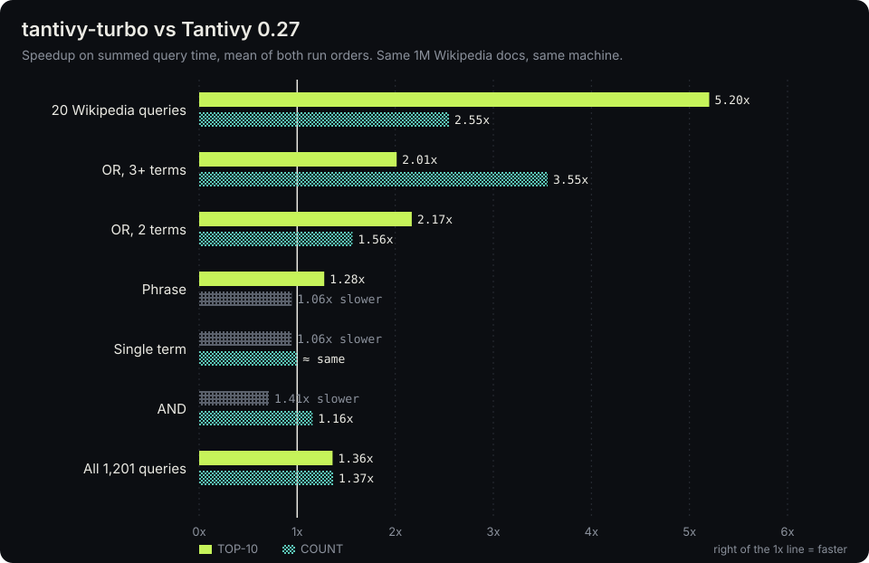
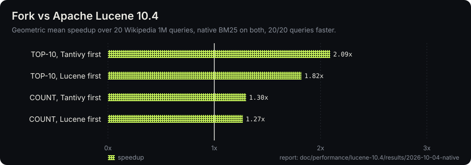

# tantivy-turbo

**A faster [Tantivy](https://github.com/quickwit-oss/tantivy). Same API, same results, Lucene-equivalent scoring.**

[](demo/tantivy-turbo-demo.mp4)

<sub>32-second demo ([MP4](demo/tantivy-turbo-demo.mp4)), rendered from Rust with [fframes](https://github.com/dmtrKovalenko/fframes); its source is in [`demo/`](demo).</sub>

tantivy-turbo is a fork of Tantivy 0.27 focused on query speed. It:

- **Runs OR queries about 2x faster than Tantivy 0.27.** MaxScore pruning covers 2–32 terms, and adaptive coarse regions are used where per-region bookkeeping would dominate.
- **Speeds up COUNT queries** with lane-based counting for medium-density terms and exact position streaming for phrase counts.
- **Scores like Apache Lucene 10.** It uses native Lucene BM25 arithmetic, overlap-discounted norms, exact field statistics and BM25 parameters you can configure. Raw scores match Lucene bit for bit on the benchmark corpus.
- **Keeps the Tantivy API.** The library is still imported as `tantivy`, so existing code compiles unchanged.

```toml
[dependencies]
tantivy = { package = "tantivy-turbo", git = "https://github.com/Priyansh4444/tantivy-turbo" }
```

## Benchmarks

### vs Tantivy 0.27



Setup:
- **Data:** the same 1M English Wikipedia documents, indexed by each engine as one segment.
- **Queries:** 1,201 queries, the [lucene-rs](https://github.com/pc-style/lucene-rs) port-style suite: 300 term, 300 AND, 301 OR and 300 phrase. Plus the 20 search-benchmark-game Wikipedia queries.
- **Execution:** both engines run warm and serially on one pinned core of the same machine (Intel Core Ultra 7 255H, on AC power).
- **Sampling:** each query is measured in rounds of 12 iterations, in both A/B and B/A order.
- **Match counts:** identical for all 1,227 queries.

Ratios are tantivy-turbo time ÷ Tantivy 0.27 time on summed per-query medians, so **below 1 means faster**. Each cell shows the A/B order first, then B/A. "Queries faster" counts per-query wins in each order.

| TOP-10 | Queries | turbo mean | 0.27 mean | Time ratio | Queries faster |
| --- | ---: | ---: | ---: | ---: | ---: |
| OR, 3+ terms | 103 | 271 µs | 550 µs | **0.49 / 0.50** | 101 / 101 |
| OR, 2 terms | 198 | 50 µs | 112 µs | **0.45 / 0.47** | 195 / 198 |
| Phrase | 300 | 251 µs | 315 µs | 0.80 / 0.77 | 127 / 114 |
| Single term | 300 | 10.0 µs | 9.2 µs | 1.08 / 1.04 | 108 / 108 |
| AND | 300 | 105 µs | 75 µs | **1.41 / 1.40** | 13 / 15 |
| **All 1,201** | 1,201 | 123 µs | 165 µs | **0.74 / 0.73** | 544 / 536 |
| Wikipedia 20 (total time) | 20 | 160 µs | 847 µs | 0.19 / 0.20 | 9 / 9 |

| COUNT | Queries | turbo mean | 0.27 mean | Time ratio | Queries faster |
| --- | ---: | ---: | ---: | ---: | ---: |
| OR, 3+ terms | 103 | 172 µs | 612 µs | **0.28 / 0.28** | 75 / 79 |
| OR, 2 terms | 198 | 37 µs | 59 µs | 0.62 / 0.66 | 90 / 63 |
| AND | 300 | 73 µs | 83 µs | 0.88 / 0.85 | 100 / 124 |
| Phrase | 300 | 326 µs | 309 µs | 1.06 / 1.06 | 91 / 112 |
| Single term | 300 | 0.4 µs | 0.3 µs | 1.06 / 0.94 | 36 / 81 |
| **All 1,201** | 1,201 | 121 µs | 160 µs | **0.75 / 0.71** | 392 / 459 |

On the Wikipedia 20 set the total-time win comes from a few heavy queries: per query, turbo is faster on 9 of 20 (geometric mean 1.28×).

Cost and compatibility:
- **Index size:** 598 MB, against 661 MB for Tantivy 0.27.
- **Peak RSS** after the full run: 186 MB, against 198 MB.
- **Reading 0.27 indexes:** tantivy-turbo reads indexes written by Tantivy 0.27.
- **Not the reverse:** Tantivy 0.27 cannot read indexes written by tantivy-turbo, because they carry extra statistics and block-bound metadata.

**Known regression:** conjunctive (AND) top-10 queries are about 1.4× slower than in Tantivy 0.27. This is the next optimization target.

Raw data and scripts are in [`bench-results/turbo-vs-tantivy-0.27`](bench-results/turbo-vs-tantivy-0.27): [`summary.json`](bench-results/turbo-vs-tantivy-0.27/summary.json), the driver [`compare.py`](bench-results/turbo-vs-tantivy-0.27/compare.py), and the upstream worker and indexer in [`upstream-harness/`](bench-results/turbo-vs-tantivy-0.27/upstream-harness).

### vs Apache Lucene 10.4



This uses the frozen search-benchmark-game Wikipedia 1M corpus and its 20 queries, with **native BM25 (k1 1.2, b 0.75) and matching collection statistics on both engines**:
- **Speed:** the fork has the lower median latency on **20/20 queries for both TOP-10 and COUNT, in both process orders**. The geometric-mean speedup is **1.82–2.09× for TOP-10** and **1.27–1.30× for COUNT**.
- **Memory:** a warmed query process uses **about 15 MiB resident, against about 617 MiB for Lucene with the default JVM heap.** That figure includes mapped index pages.

These numbers were measured on 2026-10-04, before the OR work above, so they understate the current build. Full reports, including correctness gates and raw samples:
- [native comparison](doc/performance/lucene-10.4/results/2026-10-04-native/README.md)
- [COUNT, storage and memory](doc/performance/lucene-10.4/results/2026-10-03-followup/README.md)

### vs lucene-rs (a Rust port of Lucene 10)

Ratios are tantivy-turbo time ÷ lucene-rs time on summed top-10 time, for the same 1,201 queries. Below 1 means turbo is faster.

| Term | Phrase | OR, 2 terms | OR, 3+ terms | AND | All |
| ---: | ---: | ---: | ---: | ---: | ---: |
| **0.69** | **0.87** | 0.99–1.00 | 1.51–1.53 | 1.30–1.32 | 1.06 |

- **Typical query:** across the whole suite, the per-query geometric mean is **0.835**, so tantivy-turbo is faster on the typical query.
- **Where lucene-rs still leads:** long OR and AND queries.
- **Progress on long OR:** the gap on long OR queries narrowed from 1.71× to about 1.5× in this release. This lane ran with the laptop in power-saver mode; ratios are interleaved, but absolute times are not representative.
- **Detail:** the full investigation, with every accepted and rejected attempt, is in [`doc/performance/lucene-10.4/results`](doc/performance/lucene-10.4/results).

## What changed from Tantivy 0.27

- **OR queries:**
  - MaxScore pruning for 3–32-term disjunctions: compact clause state, certified global prefixes, an exact cached threshold cutoff, and batched single-essential leaves.
  - Two-term OR pruned by its essential term.
  - Adaptive coarse MaxScore regions: queries whose per-region bookkeeping outweighs candidate work switch to wide regions. These are bounded by cached range maxima over the skip data the index already stores. q920, a 21-term query, goes from 30,242 regions to 362 and runs 2× faster.
- **Lucene-equivalent scoring:**
  - native Lucene BM25 arithmetic, with f64 accumulation in clause order;
  - overlap-discounted norms;
  - exact persisted field statistics;
  - BM25 parameters configurable per searcher;
  - Lucene-correct sloppy phrase scoring.
- **COUNT and storage:**
  - independent mask lanes for medium-density terms;
  - amortized lane horizon checks;
  - PFOR term-frequency exceptions;
  - streamed exact positions for phrase counts.
- **Correctness hardening:**
  - Block maxima are trusted only when their BM25 statistics match.
  - Saturated-frequency bounds are fixed, and absent terms are handled in block bounds.

## Correctness

- **Results:** every optimization is bit-exact. Top-10 document IDs and f32 score bits match the previous accepted build on three 1,227-query gates. Two of those gates use BM25 configurations other than the default.
- **Tests:** the full suite passes, 1,448 tests with 7 ignored. That includes exhaustive-equality fixtures that force the new coarse-region path.
- **Audit trail:** each step was kept or rejected by a frozen benchmark ruler, and the trail is published under [`doc/performance`](doc/performance).

## Building the demo video

```bash
cd demo
cargo run --release -- render -o demo.mkv   # 1080p VP9; then e.g. ffmpeg -i demo.mkv demo.mp4
```

See [`demo/README.md`](demo/README.md) for the fframes commands: preview, frames and contact sheets.

## Credits and license

tantivy-turbo is a fork of [Tantivy](https://github.com/quickwit-oss/tantivy) by Paul Masurel and the Quickwit team and contributors, with all history preserved; see [AUTHORS](AUTHORS) and [README.tantivy.md](README.tantivy.md) for the upstream documentation. Like Tantivy, it is MIT licensed ([LICENSE](LICENSE)). It is not affiliated with or endorsed by the Tantivy or Lucene projects.
