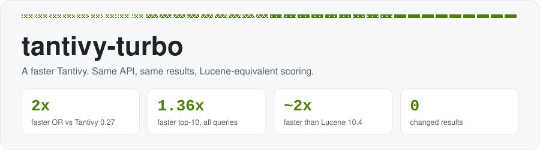
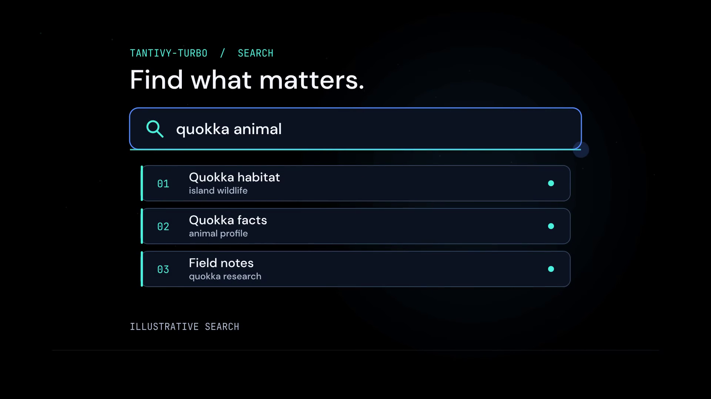
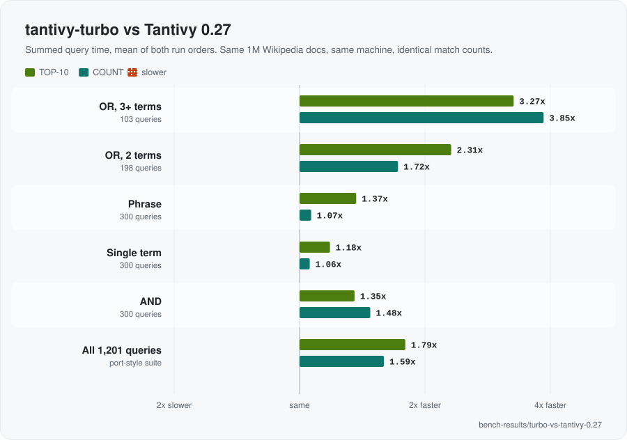
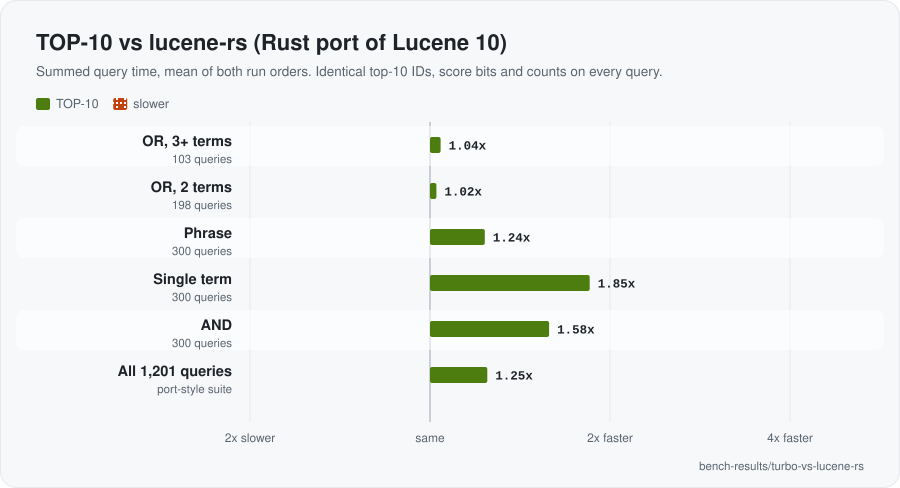

<p align="center">
  <picture>
    <source media="(prefers-color-scheme: dark)" srcset="assets/banner-dark.svg">
    
  </picture>
</p>

A faster fork of [Tantivy](https://github.com/quickwit-oss/tantivy) with Lucene 10's BM25 scoring.
Drop-in: your code keeps using the `tantivy` crate and API.

```toml
tantivy = { package = "tantivy-turbo", git = "https://github.com/Priyansh4444/tantivy-turbo" }
```

<p align="center">
  <a href="demo/tantivy-turbo-demo.mp4"></a>
  <br><sub>▶ <a href="demo/tantivy-turbo-demo.mp4">21 s demo</a></sub>
</p>

## Results

Top-10 search on 1M Wikipedia docs, 1,201 queries. The saved Tantivy and lucene-rs comparisons were measured on October 23, before a later skip-reader fix; the Lucene comparison uses an earlier build and 20 queries. Each number is the speedup in its recorded run.

| | vs Tantivy 0.27 | vs [lucene-rs](https://github.com/pc-style/lucene-rs) | vs Lucene 10.4 |
| --- | :---: | :---: | :---: |
| All queries (total time) | **1.79×** | **1.25×** | — |
| Typical query | **1.34×** | **1.49×** | **1.8–2.1×** |
| Single term | **1.18×** | **1.85×** | — |
| OR | **2.3–3.3×** | **1.02×** (2 terms), **1.04×** (3+ terms) | — |
| AND | **1.35×** | **1.58×** | faster on all |
| Phrase | **1.37×** | **1.24×** | — |
| COUNT | **1.6×** | **7.1×** | **1.3×** |
| Same results? | same matches | identical top-10 & scores | identical scores |

<p align="center">
  <picture>
    <source media="(prefers-color-scheme: dark)" srcset="assets/vs-tantivy-dark.svg">
    
  </picture>
</p>

<p align="center">
  <picture>
    <source media="(max-width: 600px) and (prefers-color-scheme: dark)" srcset="assets/vs-lucene-rs-mobile-dark.svg">
    <source media="(max-width: 600px)" srcset="assets/vs-lucene-rs-mobile-light.svg">
    <source media="(prefers-color-scheme: dark)" srcset="assets/vs-lucene-rs-dark.svg">
    
  </picture>
</p>

Full tables, Lucene per-query results, memory, methodology and how to reproduce: **[BENCHMARKS.md](BENCHMARKS.md)**.

## What's different

- **OR queries:** MaxScore pruning for 2–32 terms with Lucene-style bulk scoring windows, choosing fine or wide regions by measured cost, and scoring repeated terms once.
- **Scoring:** Lucene-style BM25. Score bits match lucene-rs on the checked query workload; the earlier Apache Lucene comparison used a numeric tolerance.
- **AND queries:** block-max windows follow the rarest term's blocks and jump straight to its next posting.
- **COUNT:** doc-frequency shortcuts, bitset counting lanes, and bit-test probes into dense blocks.
- **Index:** Lucene-style level-1 skip data every 32 blocks (jump offsets and a max-score pair per group).

## Caveats

- Reads Tantivy 0.27 indexes, but Tantivy 0.27 can't read indexes written by tantivy-turbo. Indexes from Tantivy 0.27 or older tantivy-turbo versions lack the level-1 skip data, so long OR queries run slower on them until segments are rewritten (any merge does it).

## License

MIT, like [Tantivy](https://github.com/quickwit-oss/tantivy) (by Paul Masurel, Quickwit and contributors). Upstream docs: [README.tantivy.md](README.tantivy.md).
